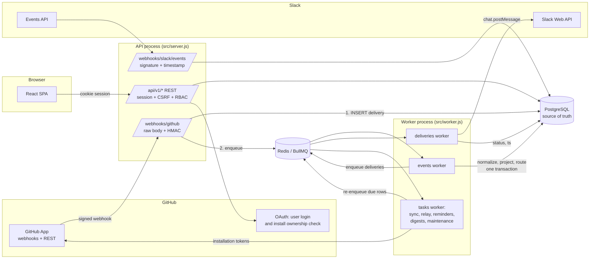

# GitWhistle Architecture

GitWhistle is a **modular monolith**: one Node.js codebase deployed as two processes (API and worker) that share PostgreSQL and Redis. The React SPA is served separately (Vite in development, nginx in Docker) on the same origin as the API.



## Layout

```
backend/src
  app.js, server.js, worker.js, container.js   composition roots
  config/env.js                                validated configuration (zod)
  database/                                    knex instance, migrate CLI, migrations
  middleware/                                  session, CSRF, workspace RBAC, errors
  queues/                                      BullMQ producers (deterministic job ids)
  workers/handlers.js                          job handlers + schedules
  shared/                                      crypto, logger, metrics, validation, audit, HTTP helpers
  modules/
    auth/           GitHub OAuth login, sessions, OAuth state
    workspaces/     tenants, members, roles, invitations, audit log API
    github/         API client, signature check, adapter (normalizer), projections, installation lifecycle
    slack/          Web API client, Block Kit renderers, signature check, Events API
    integrations/   provider registry + integration management routes/callbacks
    events/         ingestion (outbox), processor, outbox relay, activity API
    rules/          declarative schema, deterministic engine, CRUD + preview API
    notifications/  delivery creation/sending, channels API, delivery history
    pull-requests/  PR status queries
    issues/         issue queries
    reminders/      policies, scanner
    digests/        aggregation, scheduler, preview/test
    analytics/      overview endpoint
    health/         /healthz, /readyz, /metrics
client/src
  app/              router, auth context
  services/api.js   single fetch client (cookies + CSRF)
  hooks/            useApi, useMutation, useFlash
  components/ui.jsx shared UI primitives
  layouts/          authenticated shell + navigation
  features/*        one folder per page
```

## Tenancy

The tenant is a **workspace**. Every tenant-owned table has `workspace_id`. Isolation is enforced in three layers:

1. **Routing**: all tenant data lives under `/api/v1/workspaces/:workspaceId/...`. `requireWorkspace(role)` checks membership in the database on every request. Non-members get 404, so IDs cannot be probed.
2. **Queries**: every query filters by `req.workspace.id`. IDs taken from the request body or path (channels, repositories, rules) are re-checked against the workspace.
3. **Database**: composite foreign keys `(workspace_id, x_id) → x(workspace_id, id)` make cross-tenant references impossible. For example, a repository cannot point at another workspace's channel, and a delivery cannot target another workspace's channel. `test/tenancy.test.js` proves this by bypassing the application code.

A GitHub installation (`integrations.provider='github'`) belongs to at most one workspace. An installation webhook can arrive before anyone claims it. That row has `workspace_id = NULL` and its events are recorded but ignored. **Claiming requires proof of access**: after GitHub's Setup URL redirect, the user completes a second OAuth round-trip, and the API checks the installation ID against `GET /user/installations` using the user's own token. The `installation_id` in the redirect is attacker-controllable, which is why this check exists.

## Event pipeline

| Step | Where | Guarantee |
|---|---|---|
| Verify `X-Hub-Signature-256` over the raw bytes (`express.raw` on this route only) | `github/webhookRoutes.js` | Unsigned or forged requests are rejected with 401 and nothing is stored |
| `INSERT webhook_deliveries … ON CONFLICT (provider, delivery_id) DO NOTHING` | `events/ingest.js` | Durable before the 2xx response. Redeliveries are detected (200 `duplicate: true`) |
| Enqueue `evt_<rowId>` | same | Best effort. If Redis is down, still 202 and the row stays `pending` |
| Outbox relay every 30 s re-enqueues due `pending`/`failed` rows | `events/relay.js` | Rows are never stranded by a Redis outage, process crash, or Redis data loss |
| Worker locks the row (`FOR UPDATE SKIP LOCKED`), normalizes, writes the canonical event, updates PR/issue state, evaluates rules, creates deliveries, and marks the row `processed`, **all in one transaction** | `events/processor.js` | Never marked processed unless its effects committed. Concurrent re-runs are safe |
| On error: rollback, then `status=failed`, attempts+1, `next_attempt_at` with exponential backoff, attempt logged. At `EVENT_MAX_ATTEMPTS` → `dead` | same | Retry, then dead-letter. Admins can reprocess from the UI/API |
| Delivery rows have a deterministic `dedupe_key` (`event:<eventId>:<channelId>`, `reminder:…`, `digest:<ws>:<date>`) with a unique index | `notifications/deliveries.js` | A redelivered webhook, a re-run job, or a repeated scan cannot create a second message row |
| Delivery worker: claim row → send → `sent` + Slack `ts` | same | A `sent` row is never sent again |
| Slack 429 → `job.moveToDelayed(Retry-After)`. Transient → backoff. `channel_not_found`-type errors → `dead`. `token_revoked`/`invalid_auth` → integration `revoked` | same + `slack/client.js` | Rate-limit aware. Dead tokens stop being used |

**Delivery semantics are at-least-once, not exactly-once.** If a worker dies after Slack accepted a message but before the row was marked `sent`, the relay retries it after 10 minutes and the message can appear twice. Slack offers no idempotency key for `chat.postMessage`. This window is the only known duplicate path.

**Ordering**: events are not processed in strict order. PR and issue projections only apply a snapshot if its `updated_at` is not older than the stored one, so out-of-order delivery cannot regress state (tested).

## Canonical events and provider adapters

`modules/integrations/registry.js` defines the two extension points:

- **Source provider**: `isLifecycleEvent(name)` and `normalize(eventName, payload) → canonical event | null`. GitHub is implemented in `github/adapter.js`.
- **Destination provider**: `renderEvent`, `renderReminder`, `renderDigest`, `send()`, `classifyError()`. Slack is implemented in `slack/blocks.js` and `slack/client.js`.

Canonical event (stored in `events`):

```json
{
  "id": "uuid", "workspaceId": "uuid", "source": "github",
  "eventType": "pull_request.opened", "providerEventId": "<X-GitHub-Delivery>",
  "repository": { "id": "uuid", "fullName": "acme/api" },
  "actor": { "login": "bob", "externalId": "2" },
  "resource": { "type": "pull_request", "externalId": "9001", "number": 42, "title": "…", "url": "…" },
  "metadata": { "baseBranch": "main", "headBranch": "feat/x", "state": "open", "draft": false, "labels": [], "...": "..." },
  "occurredAt": "ISO-8601", "receivedAt": "ISO-8601"
}
```

The rule engine and renderers read only canonical fields. Adding GitLab means adding a source adapter, a webhook route, and installation handling. Adding Teams or Discord means adding a destination. The processor and rule engine stay unchanged. Raw payloads are kept in `webhook_deliveries.payload` for reprocessing, and purged after `WEBHOOK_PAYLOAD_RETENTION_DAYS`.

## Rule engine

`rules/engine.js` is a pure function: `evaluateRules(event, rules, { fallback, activeChannelIds })`.

- Rules are evaluated in ascending `priority`, then creation time, then id, so the result is deterministic.
- A rule matches when `all` or `any` of its conditions match. Conditions are `{ field, operator, value }` from a closed set validated with zod. There is no `eval`, and globs (`*`, `?`) are compiled with every other regex character escaped.
- A match contributes channels (de-duplicated). `priority: high` on any match makes the delivery high priority. `stopProcessing` ends evaluation. `suppress` (a mute rule) cancels every notification for the event.
- If no rule matched, **fallback routing** sends *notable* events (new, reopened, ready-for-review or merged PRs, approvals and change requests, new or assigned issues, failed workflow runs, failed deployments, published releases) to the repository's default channel or the workspace default channel. Fallback routing can be switched off per workspace.

## Pull request tracking and reminders

`pull_requests`, `pull_request_reviews` and `issues` are maintained from webhooks (`github/projections.js`) and backfilled from the REST API when a repository starts being monitored (`syncRepository`). The backfill also reconciles PRs that we think are open but GitHub no longer lists.

Derived status:

| Status | Condition |
|---|---|
| `waiting_for_review` | open, not draft, review state none/commented, or changes requested *and* the author pushed afterwards |
| `waiting_for_author` | changes requested and no push since the latest review |
| `approved` | latest non-comment review from every reviewer is APPROVED and none request changes |
| `stale` | not draft and no activity for `stale_pr.threshold_hours` (default 72 h) |

The reminder scan (every 15 min) evaluates enabled policies. **Before reminding, it re-reads the PR and its reviews from GitHub** if our copy is older than 30 minutes, and skips the cycle if GitHub is unreachable. The dedupe key is derived from the state that triggered the reminder (head SHA, requested reviewers, last review time, and so on) plus a repeat-cycle counter. The same state never reminds twice unless `repeat_hours` has elapsed.

## Daily digest

The digest scan runs every 5 min. For each workspace with digests enabled, once local time passes `digest_hour` in the workspace timezone (luxon), it inserts `daily_digests(workspace_id, digest_date)` (unique). Only the inserting scan builds the digest. The window is the previous 24 h ending at today's digest hour. Counts come from canonical events in the window. Pending reviews, stale PRs and unassigned issues come from current PR/issue state. Empty days produce a short "no activity" message. A digest that failed to build is retried, while a queued or skipped digest is never rebuilt.

## Background jobs

| Queue | Jobs | Concurrency |
|---|---|---|
| `gw-events` | `process` (one per webhook delivery) | `WORKER_EVENT_CONCURRENCY` (5) |
| `gw-deliveries` | `send` | `WORKER_DELIVERY_CONCURRENCY` (5), limiter 20/s |
| `gw-tasks` | `sync-installation`, `sync-repository`, scheduled `outbox-relay` (30 s), `reminder-scan` (15 min), `digest-scan` (5 min), `maintenance` (1 h: payload retention, expired sessions and OAuth states), `queue-metrics` (30 s) | 2 |

Job ids are deterministic (`evt_<id>`, `dlv_<id>`, `sync-repository_<id>`). Completed and failed jobs are removed from Redis because PostgreSQL holds the history.

## Observability

- Structured JSON logs (pino). Request ids. Query strings, cookies, auth headers and token-like fields are redacted. Raw payloads are never logged.
- `/healthz` (liveness), `/readyz` (database + Redis), and `/metrics` (Prometheus, bearer `METRICS_TOKEN`) on both the API (`PORT`) and the worker (`WORKER_HEALTH_PORT`).
- Metrics: `gitwhistle_webhooks_received_total`, `_rejected_total`, `_duplicate_total`, `_events_processed_total`, `_events_failed_total`, `_event_processing_latency_seconds`, `_notification_deliveries_total{outcome}`, `_github_api_errors_total{status}`, `_outbox_requeued_total`, `_queue_jobs{queue,state}`, and Node defaults.

## Decisions and trade-offs

- **JavaScript (ESM) instead of the prototype's TypeScript.** The prototype's TS was typed `any` throughout and never passed `tsc`. The brief asked for JavaScript unless a strong TS architecture existed, and every backend module was being rewritten anyway. Request validation uses zod at every trust boundary.
- **Postgres is the source of truth; Redis is a delivery mechanism.** This is what makes the outbox relay and the "Redis lost everything" recovery possible.
- **One GitHub App for login and installation.** GitHub only allows `GET /user/installations` with a user token issued to the same App, and that call is what makes the installation-ownership check possible.
- **Workspace-scoped URLs** (`/workspaces/:id/...`) rather than a session-level "current workspace". Every request states its tenant explicitly, which keeps authorization simple and auditable.
- **Prototype tables are preserved.** The first migration renames the 2025 tables to `legacy_*`, copies prototype users across, and uses a new migrations table (`gitwhistle_migrations`) so the old `.ts` migration records do not break Knex.
